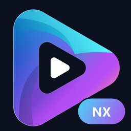

<p align="center">
  
</p>

<h1 align="center">NuvioNX</h1>

An unofficial, native **Nintendo Switch** homebrew port of
[NuvioTV](https://github.com/NuvioMedia/NuvioTV), released under **GPL-3.0** like the original.
It is **not affiliated with the Nuvio project**.

NuvioTV is a Kotlin / Jetpack Compose Android TV app, so it cannot run on the Switch's Horizon OS
as-is. NuvioNX re-implements the same experience in C++ using **libnx**, **SDL2** and **libmpv**.
It speaks the same Stremio-compatible addon protocol, so NuvioTV addons work unchanged.

> **Status:** works on real hardware (title-override launch): addons load, 1080p streams play with
> audio, Trakt and Nuvio account sync, touch and controllers. 4K is not usable (the Switch cannot
> decode it smoothly). See **Known limitations**.

---

## Install (just want to run it)

1. Get `nuvionx.nro` (build it — see below — or download it from the repo's
   [Releases](../../releases) if one is published).
2. Copy it to `sdmc:/switch/` on your SD card.
3. Launch it through **title override**: hold **R** while starting any installed game, then open
   NuvioNX from the Homebrew Menu. **Do not launch from the Album** — homebrew launched there gets
   very little memory and video playback will fail or crash.
4. All app data lives in `sdmc:/switch/NuvioNX/`.

First run: open the **Addons** tab and install a Stremio-compatible addon (Cinemeta + OpenSubtitles
are added by default). To avoid typing URLs on the Switch, open `http://<switch-ip>:8080` from a
phone/PC on the same Wi-Fi (the Addons tab shows the address) and paste them there.

---

## Features

- **Home** — hero banner, Continue Watching, and catalog rows from every enabled addon (infinite
  scroll / paging).
- **Detail page** — artwork, logo, rating, genres, cast, seasons & episodes, mark watched/unwatched.
  Every item opens here first (description + episode picker), then you choose a source.
- **Sources** — every stream addon queried in parallel, filterable per addon.
- **Player** (mpv/FFmpeg) — resume, seek, audio & subtitle track menus, addon subtitles in your
  language, next-episode autoplay, hardware decoding (Tegra) when available, info overlay.
- **Search**, **Library**, **Settings** (6 themes, languages, 720p/1080p output, CPU boost, etc.).
- **Debrid** — Real-Debrid / TorBox / Premiumize; torrent results resolve to direct links.
- **Nuvio account** — device-code sign-in + pulls addons, debrid keys, library, watch progress.
- **Trakt** — device-code sign-in, pulls progress/history/watchlist, scrobbles what you watch.
- **Battery + clock** in the top bar.
- **Controllers + touch** — Joy-Con (attached / grip / single sideways), Pro Controller, handheld;
  tap and swipe in handheld mode.

---

## Controls

| Button | Navigation | Player |
|---|---|---|
| D-pad / sticks | Move focus | ◀▶ seek 10s, ▲▼ show controls |
| A | Select / open | Play / pause |
| B | Back | Exit player |
| L / R | Switch tabs / seasons / stream filters | Seek 60s (also ZL/ZR) |
| Y | Library / new search / mark watched | Subtitles |
| X | Remove (Continue Watching, addons) | Audio tracks |
| − | — | Info overlay (Y there = save log) |
| + | Exit app | — |

In handheld mode you can tap items, swipe to scroll, and tap the on-screen hint pills.

---

## Accounts & importing your setup

All of these are optional. API keys/URLs are **not** bundled — you supply your own. The easiest way
to enter long values is from a phone/PC browser: with NuvioNX open, go to `http://<switch-ip>:8080`
(addons) or `http://<switch-ip>:8080/account` (Nuvio + Trakt), which saves straight to the Switch.

### Import from Nuvio for Windows

If you already use the official **Nuvio for Windows** app, you can copy your setup over in one step:
addons (order + enabled state), library + Trakt watchlist, watch progress and watched history.

1. On the PC with Nuvio installed, open `tools/switchip.txt` and put your Switch's IP on the last
   line (the Addons tab shows it as `http://<ip>:8080`).
2. Open NuvioNX on the Switch (same Wi-Fi) and double-click **`tools/import-to-my-switch.cmd`**.

Re-running never creates duplicates. Full details and the Wi-Fi-less (SD card) method are in
[`tools/README.md`](tools/README.md).

### Connect a Nuvio account

Pulls your addons, debrid keys, library and watch progress from your Nuvio account.

1. **Account** tab → **Use official Nuvio server** (sets the Nuvio API URL), then paste your Nuvio
   **publishable key** when prompted. The key is published in Nuvio's own API docs; it isn't bundled
   here. (Or enter a self-hosted server URL + key instead.)
2. Choose **Sign in with code** → a QR code and a short code appear.
3. Scan the QR with your phone, or open **nuvio.tv/link** and enter the code, then approve.

It signs in and imports automatically, and re-syncs on every launch (plus a **Sync now** button).
Sync is pull-only — watching on the Switch doesn't push back to the Nuvio account.

### Connect Trakt

Pulls your Trakt progress, watched history and watchlist, and **scrobbles** what you watch
(start/pause/stop; Trakt marks things watched past ~80%).

1. Create a free Trakt API app at **<https://trakt.tv/oauth/applications/new>**:
   - **Redirect uri:** `urn:ietf:wg:oauth:2.0:oob`
   - Save, then copy the **Client ID**. A Client Secret is **not needed** for newer (PKCE) apps —
     NuvioNX signs in with the Client ID alone.
2. On the Switch: **Account** tab → press **Right** to the Trakt column → **Enter Client ID**
   (or paste it at `:8080/account`).
3. Choose **Connect Trakt** → scan the QR, or open **trakt.tv/activate** and enter the code, then
   approve.

> Trakt ties each sign-in to the app that created it, so a login from NuvioTV can't be reused — you
> connect once with your own Trakt app as above. It reaches the same Trakt account and data.

---

## Build from source

You need **devkitPro** (devkitA64 + libnx) and a few portlibs. On Windows this was built with
**MSYS2** plus devkitPro's pacman repositories.

### One-time toolchain setup (Windows / MSYS2)

```sh
# In an MSYS2 shell, after adding the devkitPro pacman repos
# (https://devkitpro.org/wiki/devkitPro_pacman):
pacman -S --needed make pkgconf \
  switch-dev switch-sdl2 switch-sdl2_ttf switch-sdl2_image switch-curl switch-libmpv
```

`pkgconf` is required — the devkitPro `aarch64-none-elf-pkg-config` wrapper calls it.

### Build

```sh
export DEVKITPRO=/opt/devkitpro
make -j$(nproc)
# or just:
./build.sh
```

Output is `nuvionx.nro`. TLS uses the Switch's system SSL service and its built-in trusted
certificates, so no CA bundle is shipped.

---

## Project layout

```
source/
  main.cpp              entry point, fatal-error screen
  app.*                 app loop, screen stack, addon registry, account/Trakt sync, import
  net.*                 libcurl + worker thread pool + main-thread dispatch
  json.*                small JSON parser/serializer (no deps)
  stremio.*             addon protocol: manifest, catalog, meta, stream, subtitles
  store.*               settings, addons, progress, library (SD card), batched writes
  account.*             Nuvio account: device-code login + sync pull
  trakt.*               Trakt.tv: device-code login, pull, scrobble
  debrid.*              Real-Debrid / TorBox / Premiumize direct resolution
  proxy.*               local HTTP->HTTPS relay for the player (FFmpeg has no https)
  sdfile.*              native Switch FS reads/writes (avoids newlib fd-table crashes)
  gfx.*                 SDL renderer helpers, text cache, async image cache, themes
  input.*               libnx pad + touch -> navigation with key repeat
  ui.*                  widgets: poster rows, backdrop, buttons, chips, hint bar, keyboard
  diag.*                in-memory diagnostics log (written to SD only on demand/failure)
  lan.*                 LAN web form (addon install + account/Trakt setup + import) on :8080
  screens/             main tabs, home, search+library, addons, account, settings,
                       detail, streams, player
  third_party/         qrcodegen (Nayuki, MIT) for sign-in QR codes
tools/                  PC-side helper scripts (see tools/README.md)
Makefile, build.sh     devkitPro build
icon.jpg               NRO icon
```

See `ARCHITECTURE.md` for how the pieces fit together and the non-obvious Switch gotchas.

---

## Known limitations

- **Torrent streams need a debrid service** (Real-Debrid / TorBox / Premiumize). The Switch can't
  run a torrent engine; uncached torrents are reported, not downloaded.
- **4K is not usable.** 1080p H.264 is the comfortable ceiling even with hardware decode; frames are
  still scaled on the CPU.
- **Sync pulls down only** — watching on the Switch doesn't push back to a Nuvio account (Trakt
  scrobbling does push).
- **System font only** — no CJK glyphs.
- Nuvio's and Trakt's API keys are **not** bundled; you enter your own (see the Account tab).

---

## Credits & license

- **NuvioNX** is a port of **[NuvioTV](https://github.com/NuvioMedia/NuvioTV)** (GPL-3.0). This
  project is also **GPL-3.0** — see `LICENSE`.
- Built with [devkitPro](https://devkitpro.org/), [libnx](https://github.com/switchbrew/libnx),
  SDL2, [mpv](https://mpv.io/) / FFmpeg, and [libcurl](https://curl.se/).
- QR codes: [QR-Code-generator](https://github.com/nayuki/QR-Code-generator) by Project Nayuki (MIT).
- The Nuvio name and logo belong to the Nuvio project; this is an unofficial fan port. If you
  redistribute builds, keep them clearly labelled as unofficial.
